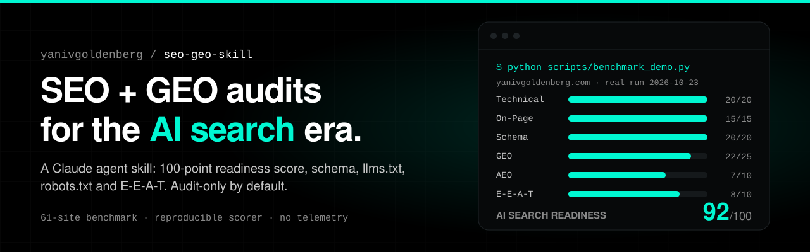
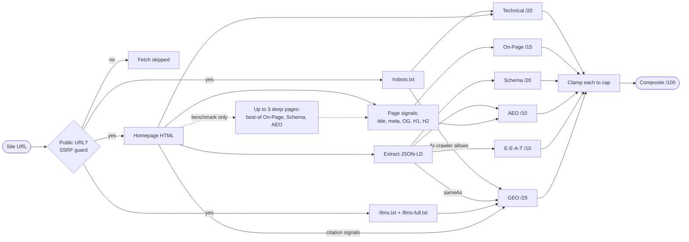

<p align="center">
  <picture>
    <source media="(prefers-color-scheme: dark)" srcset="assets/banner-dark.svg">
    <source media="(prefers-color-scheme: light)" srcset="assets/banner-light.svg">
    
  </picture>
</p>

<h3 align="center">Score and fix how well AI search engines can read, trust and cite a website.</h3>

<p align="center">
  <a href="https://github.com/yanivgoldenberg/seo-geo-skill/actions/workflows/ci.yml"></a>
  <a href="CHANGELOG.md"></a>
  <a href="requirements-dev.txt"></a>
  <a href="LICENSE"></a>
  <a href="docs/state-of-ai-search-2026.md"></a>
  <a href="seo-geo.md"></a>
</p>

<p align="center">
  <a href="#quickstart">Quickstart</a> ·
  <a href="docs/SCORING.md">Scoring rubric</a> ·
  <a href="docs/state-of-ai-search-2026.md">2026 benchmark</a> ·
  <a href="docs/README.md">Docs</a> ·
  <a href="CHANGELOG.md">Changelog</a>
</p>

---

## Contents

- [What it does](#what-it-does)
- [Quickstart](#quickstart)
- [Real example output](#real-example-output)
- [Features](#features)
- [How scoring works](#how-scoring-works)
- [Benchmark highlights](#benchmark-highlights)
- [What this score is, and is not](#what-this-score-is-and-is-not)
- [Use it in your agent](#use-it-in-your-agent)
- [FAQ](#faq)
- [Roadmap](#roadmap)
- [Contributing](#contributing)
- [License](#license)
- [Attribution & fingerprint](#attribution--fingerprint)
- [Built by Yaniv Goldenberg](#built-by-yaniv-goldenberg)

---

## What it does

- **Audits** a site against one 100-point AI Search Readiness rubric: Technical 20, On-Page 15, Schema 20, GEO 25, AEO 10, E-E-A-T 10 ([rubric](docs/SCORING.md)).
- **Fixes** what it finds, phase by phase: JSON-LD schema, `llms.txt`, `robots.txt` AI-crawler rules, entity anchoring, answer-engine structure, agent-readiness signals. Writes are opt-in and dry-run gated.
- **Proves** it: a reproducible Python scorer, a public 61-site benchmark, and a monthly GitHub Action that commits fresh snapshots.

## Quickstart

Python 3.12. Linux, macOS or WSL2:

```bash
git clone https://github.com/yanivgoldenberg/seo-geo-skill.git && cd seo-geo-skill
python3.12 -m venv .venv && .venv/bin/python -m pip install -r requirements.txt
.venv/bin/python scripts/benchmark_demo.py https://yoursite.com
```

Windows PowerShell: use `py -3.12 -m venv .venv`, then `.venv\Scripts\python.exe` in place of `.venv/bin/python`, and set `$env:PYTHONUTF8 = '1'` before running the test suite. Full guide: [Installation](docs/setup/installation.md).

With no URL, `benchmark_demo.py` scores the two reference sites shown below. The demo reads only public URLs (`/`, `/robots.txt`, `/llms.txt`, `/llms-full.txt`), refuses private and local addresses, and identifies itself with a `seo-geo-skill/<version>` User-Agent.

## Real example output

Captured on 2026-10-23 from a clean checkout with `python scripts/benchmark_demo.py`:

```text
Site                    Tech   Sch   GEO   OnP   AEO  EEAT  TOTAL
-------------------------------------------------------------
yanivgoldenberg.com       20    20    22    15     7     8     92
openai.com                17     0     6    13     0     0     36
-------------------------------------------------------------
max points                20    20    25    15    10    10    100
```

The demo scores the homepage only. The benchmark (`score(url, pages=4)`) also takes the best On-Page, Schema and AEO result across up to 3 discovered deep pages, so the two are not directly comparable. For reference, openai.com scored 7 in the 2026-06-23 canonical dataset and 41 in the 2026-10-01 monthly snapshot; sites change between runs too.

## Features

| Area | What you get | Where |
|---|---|---|
| Phase 0 audit | 100-point score across 6 dimensions, non-destructive | [seo-geo.md](seo-geo.md#phase-0---audit-always-run-first) |
| Technical + on-page | robots, sitemaps, canonicals, titles, meta, Core Web Vitals, hreflang, internal links | Phases 1, 2, 8, 9, 13 |
| Structured data | 18 schema types with validated JSON-LD fixtures | Phase 3, [examples/](examples/) |
| GEO (AI search) | `llms.txt` + `llms-full.txt`, entity anchoring with `sameAs`, AI-crawler access, citation-worthy content | Phase 4 |
| AEO | FAQPage, Speakable, question-style headings | Phase 5 |
| E-E-A-T | author, dates, `knowsAbout`, trust signals | Phase 6 |
| Agent readiness | Content Signals, IETF `Content-Usage`, RSL licensing, markdown twins, Web Bot Auth | Phase 21 |
| Content integrity | source-verified claims, per-page reader review, no invented statistics | Phase 22 |
| Safe writes | dry-run gates, banned-endpoint list, SSRF guard, opt-in `--apply` | Phase 17 |
| Platform adapters | WordPress, Shopify, Webflow, Next.js | Phase 18, [examples/](examples/) |
| Benchmarking | head-to-head competitor scoring, 61-site public leaderboard, monthly snapshots | Phase 19, [docs/](docs/README.md) |

Schema types covered: `Person` `Organization` `SoftwareApplication` `LocalBusiness` `Product` `Service` `Article` `BlogPosting` `FAQPage` `HowTo` `BreadcrumbList` `WebSite` `ProfilePage` `DefinedTerm` `Review` `SpeakableSpecification` `VideoObject` `ItemList`

## How scoring works

The automated scorer is `score()` in [`tests/benchmark_sites.py`](tests/benchmark_sites.py). It awards only crawl-observable checks, each with a fixed point value, and clamps every dimension to its cap. The full check list is in [SCORING.md](docs/SCORING.md) and is pinned by `tests/test_scoring_parity.py`.



The full skill rubric in `seo-geo.md` scores more than a crawler can see (for example content quality and off-site entity presence). The benchmark scores the crawl-observable subset on the same six buckets and 100-point scale.

## Benchmark highlights

Computed from [`docs/state-of-ai-search-2026.json`](docs/state-of-ai-search-2026.json), the canonical dataset scored 2026-06-23: 61 public SaaS and AI sites, 3 canary rows excluded.

- **Mean 54.3, median 59.** 34 of 61 sites (56%) scored 60 or below; 4 scored 80 or above.
- **Schema is the widest gap.** 22 of 61 homepages scored 0 of 20 on Schema; 52 scored 0 of 10 on E-E-A-T; 31 scored 0 of 10 on AEO.
- **37 of 61 publish a `text/plain` `/llms.txt`.** It is worth 2 of 25 GEO points (3 with `llms-full.txt`) because file presence does not establish use in answers or rankings.

The bottom of the canonical leaderboard:

| Rank | Site | Score | Notable |
|---:|---|---:|---|
| 59 | **canva.com** | **13** | *No JSON-LD schema, no AI-crawler allow.* |
| 60 | **openai.com** | **7** | *Zero JSON-LD schema on homepage.* |
| 60 | **perplexity.ai** | **7** | *Same profile as OpenAI.* |

These are low scores on this readiness rubric, not measured invisibility in AI answers. The 2026-10-01 monthly snapshot (60 fresh rows, 1 carried) has a mean of 59.5; see [history](docs/state-of-ai-search-history/README.md). Full leaderboard and methodology: [State of AI Search Visibility 2026](docs/state-of-ai-search-2026.md). Worked fix path: [OpenAI case study](docs/case-study-openai.md).

<details>
<summary><b>Original 13-site cohort</b> (first public benchmark, 2026-04-24, v1.6.0 calibration; a different run, so scores differ from the 61-site study)</summary>

| Rank | Site | Score |
|---:|---|---:|
| 1 | yanivgoldenberg.com | 90 |
| 2 | stripe.com | 73 |
| 2 | resend.com | 73 |
| 4 | planetscale.com | 65 |
| 5 | vercel.com | 63 |
| 5 | figma.com | 63 |
| 7 | notion.so | 60 |
| 8 | mercury.com | 58 |
| 9 | supabase.com | 55 |
| 10 | linear.app | 53 |
| 11 | anthropic.com | 30 |
| 12 | ramp.com | 25 |
| 13 | fly.io | 10 |

Per-dimension breakdown: [`docs/benchmarks.md`](docs/benchmarks.md).

</details>

## What this score is, and is not

- **It is machine-legibility.** How cleanly a crawler, an LLM or an answer engine can parse your entity, schema and stated facts.
- **It is not a ranking promise.** Google states no special file is required to appear in AI Overviews. Citations depend on each engine, your authority and your content.
- **Correlation stays correlation.** Patterns in the benchmark are reported as patterns, not causal levers.
- **It is reproducible.** Same scorer, same checks, dated snapshots. If your run disagrees with a number here, [open an issue](https://github.com/yanivgoldenberg/seo-geo-skill/issues) with the output.

## Use it in your agent

Open the clone in Claude Code (or another agent) and ask it to load `seo-geo.md` and `docs/SCORING.md`, then run an audit-only review of your site. Reading the skill grants no credentials and changes nothing. When registered as a slash command, the interface is:

```bash
/seo-geo https://yoursite.com          # full audit, then ranked fixes
/seo-geo --audit-only                  # score only, no writes
/seo-geo --phase geo                   # one phase (geo, technical, ...)
/seo-geo --page <url>                  # single page
/seo-geo --benchmark <competitor>      # head-to-head score
/seo-geo --apply                       # writes enabled (opt-in, see Phase 17)
```

Slash-command registration is agent-specific; a Git clone alone does not register it. See [Installation](docs/setup/installation.md).

## FAQ

<details>
<summary><b>What is GEO?</b></summary>

Generative Engine Optimization: making a site easy for AI answer engines (ChatGPT, Claude, Perplexity, Google AI Overviews) to parse, attribute and cite. Here it is the 25-point GEO dimension: entity presence, citation-worthy content, AI-crawler access and `llms.txt` hygiene.
</details>

<details>
<summary><b>Does it change my site?</b></summary>

Not by default. Phase 0 is read-only. Writes need explicit `--apply`, pass dry-run gates, and never touch password, user-deletion or credential-rotation endpoints (Phase 17 banned list).
</details>

<details>
<summary><b>Does it send data anywhere?</b></summary>

No telemetry. The only outbound requests are to the site you score, with an identifying User-Agent.
</details>

<details>
<summary><b>Why is <code>llms.txt</code> worth so few points?</b></summary>

Requests for the file do not establish that any engine uses it in answers or rankings, and current Google Search guidance does not require it. It was de-weighted on 2026-06-23 ([proposal](docs/proposals/scoring-reliability.md)).
</details>

<details>
<summary><b>Can I use it at work or for clients?</b></summary>

On sites you or your company own or operate: yes, including internal audits at a for-profit company. For clients, as a paid service, or in anything sold: written permission first. See [License](#license).
</details>

<details>
<summary><b>Does it only work with Claude?</b></summary>

The skill is a Markdown file any capable agent can follow; it is written for Claude Code. The scorer and tests are plain Python 3.12.
</details>

## Roadmap

Open directions, not dated commitments. Proposals welcome via [issues](https://github.com/yanivgoldenberg/seo-geo-skill/issues).

- [x] Monthly 61-site benchmark snapshot, committed by GitHub Action
- [x] Agent-readiness phase (Content Signals, `Content-Usage`, RSL, Web Bot Auth)
- [x] Content integrity and reader review (Phase 22)
- [ ] More platform adapters (Ghost, Astro, Craft CMS) following the Phase 18 pattern
- [ ] More validated JSON-LD fixtures in `examples/`
- [ ] Community case studies in the [case-study format](docs/case-studies/yanivgoldenberg.com.md)

## Contributing

Bug reports with real output, platform adapters, schema fixtures and regression tests are welcome. Read [CONTRIBUTING.md](CONTRIBUTING.md) and the [Code of Conduct](CODE_OF_CONDUCT.md); report security issues privately per [SECURITY.md](SECURITY.md). Researchers: cite via [CITATION.cff](CITATION.cff).

## License

[PolyForm Noncommercial 1.0.0](LICENSE) ([official text](https://polyformproject.org/licenses/noncommercial/1.0.0)) with an additional own-site permission in [COMMERCIAL.md](COMMERCIAL.md). Names and marks: [TRADEMARK.md](TRADEMARK.md). Every copy must keep the attribution line in [NOTICE](NOTICE).

| Use case | Allowed | License required |
|---|---|---|
| Run on your own site | Yes | No |
| Run inside your company for internal audits of its own sites | Yes | No |
| Fork and modify for personal or internal use | Yes | No |
| Run on client sites as part of your service | Only with written permission | Contact for permission |
| Resell as a paid product or SaaS | No | Commercial license |
| White-label or package under your brand | No | Commercial license |
| Embed in a commercial tool you sell | No | Commercial license |

Permission or a commercial license: [yanivgoldenberg.com/contact](https://yanivgoldenberg.com/contact/).

## Attribution & fingerprint

This project carries visible, disclosed footprints so copies stay attributable. None of them sends data anywhere.

- **NOTICE.** The `Required Notice:` line in [NOTICE](NOTICE) must be kept in every copy (PolyForm Noncommercial, Notices clause). Source files carry an `SPDX-License-Identifier: PolyForm-Noncommercial-1.0.0` header.
- **Fingerprint.** Project ID `YG-SEOGEO-754F1B9DC9A7` appears in the code (`tests/project_meta.py`), the skill file (`seo-geo.md`) and the benchmark dataset. Search for it to find copies.
- **Canary rows.** `docs/state-of-ai-search-2026.json` and `.csv` end with 3 fictional rows on reserved domains (`northwind-lighthouse.example`, `quillmere-analytics.invalid`, `brightfern-labs.example`) flagged `canary: true` (`canary=true` and `source=canary-YG-SEOGEO-754F1B9DC9A7` in the CSV). They are not measurements, are never fetched, and are excluded from every statistic. Filter them out if you analyze the data.
- **User-Agent.** Every outbound HTTP request the tools make identifies itself as `seo-geo-skill/<version> (+https://yanivgoldenberg.com/)`, so site owners can see who is crawling.
- **No telemetry.** Nothing calls home, automatically or otherwise.

## Built by Yaniv Goldenberg

**[Yaniv Goldenberg](https://yanivgoldenberg.com/)**, Fractional Head of Growth · [LinkedIn](https://www.linkedin.com/in/yanivgoldenberg/) · [The skill, hosted](https://yanivgoldenberg.com/ai-search-readiness/)

Want it applied to your site by the author? A paid AI Search Visibility Audit is available; see an illustrative [sample deliverable](docs/sample-paid-audit.md) and [apply here](https://yanivgoldenberg.com/contact/).

**Register your use (optional, manual):** if you use this skill, tell me at [yanivgoldenberg.com/contact](https://yanivgoldenberg.com/contact/?source=seo-geo-skill). Nothing is sent automatically.
